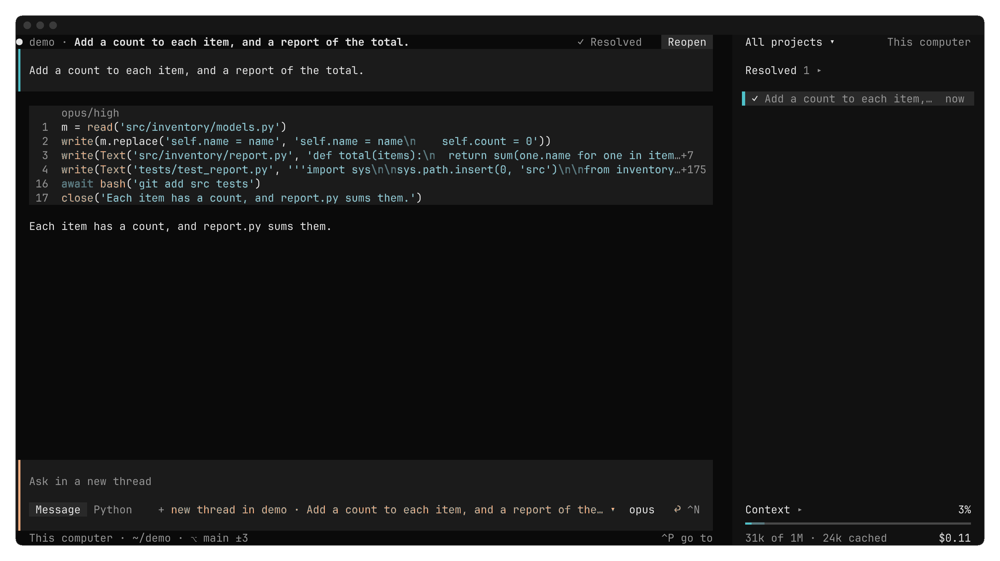
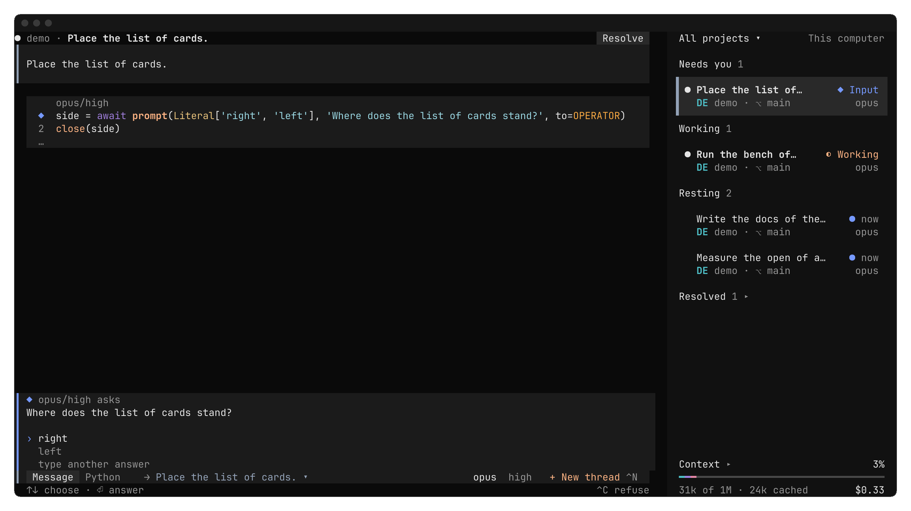

<div align="center">

# furb

**An AI agent that writes Python instead of calling tools, in sessions that last for months.**

[](https://github.com/uael/furb/actions/workflows/gates.yml)



</div>

Most agents make the model choose one tool call at a time. furb lets the model write Python instead.

In one reply, the model reads files, starts ten commands at once, asks other models, loops until the tests pass, and
keeps a function for the next time it needs it. furb runs each line as soon as the model writes it, and shows the
model what happened. The model decides only what code cannot. Loops, retries and fan-out are plain Python.

A session of furb is also made to last. Each step goes into a record. Close the window and come back next month: the
session opens where you left it, and a new version of furb opens it too, as
[the promise](https://github.com/uael/furb/blob/main/docs/promise.md) says. Keep one session that reviews your pull
requests, one that does your taxes each year, one that runs your week. The functions that its models wrote, its notes
and its kits stay, so each task starts from what the tasks before it built. That is compounding.

## Try it in a minute

You need Python 3.14 and a model: the `claude` command line, an API key such as `ANTHROPIC_API_KEY`, or a local
server that `FURB_LOCAL_URL` names. Two prompts on one record are two visits to one session, and the second one knows
what the first one read.

```sh
pip install furb
furb prompt --record repo.jsonl "Read this repository and tell me what it does."
furb prompt --record repo.jsonl "Now list its three riskiest parts."
```

## Why furb

**One reply can replace a dozen turns.** A harness of tool calls needs a new turn of the model each time it must
choose what to do with a result. In furb, the model writes the choice. Here is one reply that reviews a diff and fixes
the tests, from start to end with no turn in between:

```python
changed = (await bash("git diff --name-only main")).stdout.content.split()
reviews = [prompt(str, f"Find the bugs in {path}.", on=chain(path)) for path in changed]
found = []
for review in reviews:
  found.append(await review)
fixer = chain("fix")
tests = await bash("cargo test", ok=True)
while tests.code:
  await prompt(None, f"Fix this failure:\n{tests.stdout.content}", on=fixer)
  tests = await bash("cargo test", ok=True)
close("\n\n".join(found))
```

It asks one model for each changed file, all at the same time, on chains of their own. Then it fixes the tests until
they pass, and gives its report. A chain is a conversation with its own state. A prompt is a call like any other, so
a model can ask a model as easily as it runs a command.

**Sessions that last.** A session is a record that only grows. furb replays it exactly, so a crash or a reboot loses
nothing. A large session opens quickly from an image of its last state. The functions that a model wrote
stay bound, so the next task starts where the last one stopped.

**Nothing is hidden.** The system prompt is the source code of the engine: one Python file,
[`src/furb/engine.py`](https://github.com/uael/furb/blob/main/src/furb/engine.py), of about 8000 tokens. The
model reads how its own runtime works, line by line, and so can you. The transcript is the exact text that the model
reads, and [an audit](https://github.com/uael/furb/blob/main/docs/audit.md) checks a record with no model and no
network.

**Any model.** Use the Claude subscription of your `claude` command line, a ChatGPT subscription, an API key of any
provider that [models.dev](https://models.dev) lists, or a model on your own machine.
[The page of models](https://github.com/uael/furb/blob/main/docs/models.md) says how.

**Make it yours.** A skill or a script becomes Python that furb runs: a kit. A kit can run a process of its own, in
Python or TypeScript, and add its own parts to the window, live, while you work.
[Extensions](https://github.com/uael/furb/blob/main/docs/skills.md) says how they work.

**Many things at once.** Each thread of each session of the machine stands in one list, with what works now and what
waits for you first. You can pause, cancel or steer any work while it runs, and a chain that waits for you does not
stop the others.

> [!WARNING]
> **furb asks for no permission, on purpose.** Each command that a model writes runs with the rights of your user,
> with no step where you approve it. Most people already run their agent this way, and a question that comes fifty
> times a day protects nobody. Real safety is a boundary: for work that you do not trust, run furb in a container or a
> virtual machine that holds only what the work needs. If you want finer permissions, as Claude Code has them, write
> them as a kit.

## Install

| Where | Command | What you get |
| --- | --- | --- |
| PyPI | `pip install furb` | The Python package and `furb`, the command line. It needs Python 3.14 or later. |
| npm | `npm install furb@npm:@uael/furb` | The engine for Node.js 22 or later and Bun 1.4.2 or later, with no Python. |
| Rust | `cargo add furb --git https://github.com/uael/furb` | The engine for a program of Rust, with no Python. Copy the [`Cargo.lock`](https://github.com/uael/furb/blob/main/Cargo.lock) of furb into a new crate before its first build, since a newer version of a dependency can break the build. |

> [!NOTE]
> crates.io holds only an empty furb 0.0.0 and an empty furb-cli 0.0.0, which keep the names, so Rust takes furb
> from git. crates.io will hold furb when the interpreter that furb runs on is there too.
> [`CHANGELOG.md`](https://github.com/uael/furb/blob/main/CHANGELOG.md) says what each release holds.

furb asks the models of each provider whose key stands in the environment, such as `ANTHROPIC_API_KEY` or
`OPENAI_API_KEY`, and the models of a local server that `FURB_LOCAL_URL` names.
[The page of models](https://github.com/uael/furb/blob/main/docs/models.md) says how to choose one.

## The window

The window is not packaged yet. To try it today, build it from a clone, with Git, the Rust toolchain and
[Zig](https://ziglang.org/download/) 0.17.1. Its first build takes some minutes:

```sh
git clone https://github.com/uael/furb && cd furb
cargo build -p furb-cli -p furb-window  # furb and its window, side by side in target/debug.
target/debug/furb                       # The window, on the daemon of this machine, which it starts when none runs.
```

On Windows the window also needs the library of OpenTUI beside it, as
[the window](https://github.com/uael/furb/blob/main/CONTRIBUTING.md#the-window) says.

Type a message and press Enter: it starts a new session in the project of the folder, and its thread shows each word
that the model writes and runs. The list at the right holds each thread of the machine, and what waits for you
first. `furb` with no command starts the same window.



## In your own program

In a program, a life is a few lines. This one asks for a plan, and keeps its record in `release.jsonl`:

```python
import asyncio

import furb


async def main() -> None:
  life = await furb.open("release.jsonl")
  plan = await life.prompt(str, "Plan the release of version 2.")
  print(plan)


asyncio.run(main())
```

Stop it while the model works, and run it again: it finds its prompt in the record and goes on, and no answer of
the model is asked for twice. [The examples](https://github.com/uael/furb/blob/main/docs/examples/README.md) show the
same program in TypeScript and in Rust, and four more.

## The words of furb

- A **life** is one run of furb, and its **record** is the file that holds it.
- A **chain** is a conversation with its own state. A life starts with one chain, and a word can start more.
- A **prompt** asks a model, or you, for an answer of a type, such as `str` or `int`.
- A **word** is the Python that a model writes for one step, and a **rung** runs it.
- An **act** is each thing that a word does: a read, a command, a prompt, a wait.
- The **operator** is you.

## Documentation

| To | Read |
| --- | --- |
| Use the window | [The window](https://github.com/uael/furb/blob/main/CONTRIBUTING.md#the-window): its keys, and how to build it |
| Choose a model, or use a local one | [Models](https://github.com/uael/furb/blob/main/docs/models.md) |
| Use furb from a program | [The examples](https://github.com/uael/furb/blob/main/docs/examples/README.md), [Python](https://github.com/uael/furb/blob/main/bind/python/README.md), [TypeScript](https://github.com/uael/furb/blob/main/bind/typescript/README.md) |
| Use the command line | [The command line](https://github.com/uael/furb/blob/main/cli/README.md), and [its protocol](https://github.com/uael/furb/blob/main/docs/protocol.md) |
| Extend furb | [Extensions](https://github.com/uael/furb/blob/main/docs/skills.md) |
| See what may come | [Ideas for later](https://github.com/uael/furb/blob/main/docs/ideas.md) |
| Check a record that someone gave you | [The audit](https://github.com/uael/furb/blob/main/docs/audit.md) |
| Know what a release keeps | [The promise](https://github.com/uael/furb/blob/main/docs/promise.md): within a major, each life opens and resumes with no drift, from 1.0.0 |
| Change furb | [Contributing](https://github.com/uael/furb/blob/main/CONTRIBUTING.md), and [the contract](https://github.com/uael/furb/blob/main/src/furb/engine.pyi), every law of the engine |

## License

> Copyright (C) 2026 Abel Lucas. furb is free software under the GNU Affero General Public License, version 3,
> which `LICENSE` holds. You may use, study, change, and share it. Anyone who ships it, or who runs a changed furb
> as a service, must offer the source under the same terms. The engine carries no notice of its own, because its
> text is the system prompt of a model and every word of it counts.
