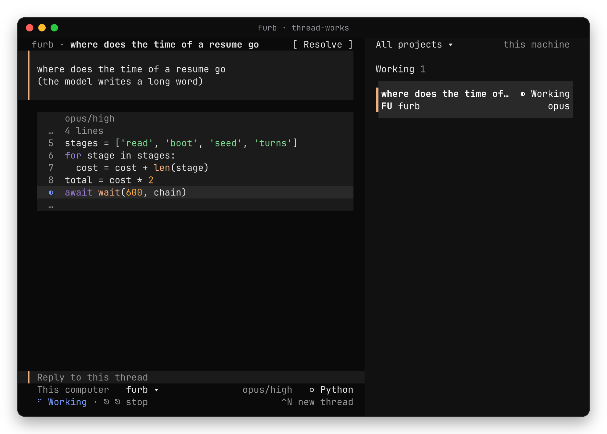
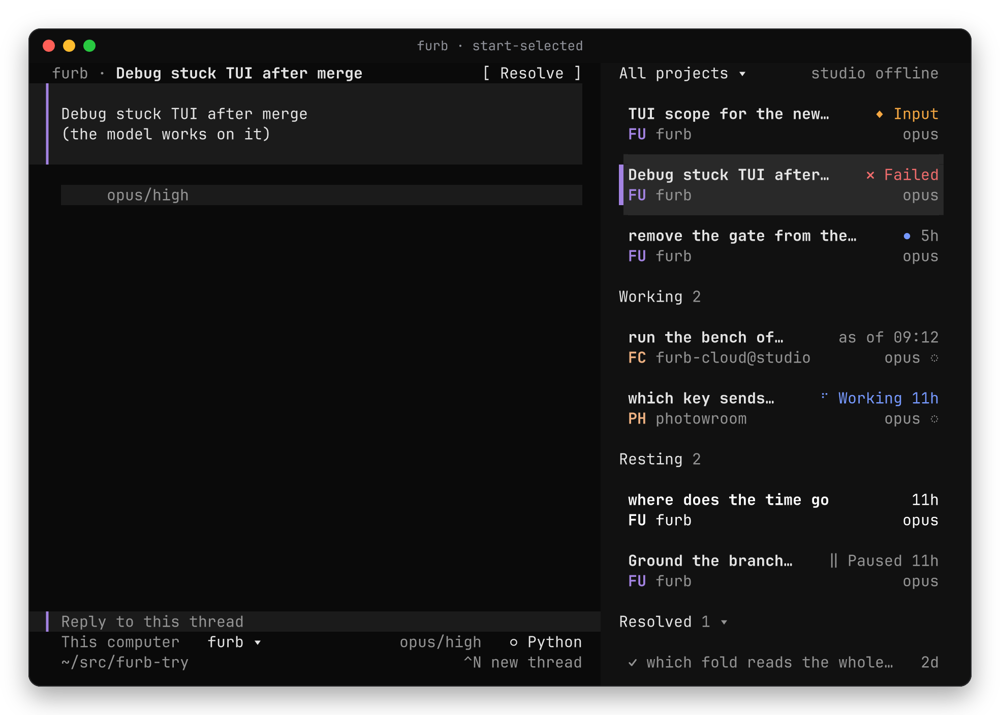

<div align="center">

# furb

**An AI agent that answers in Python, on a record that you can read, replay and audit.**

[](https://github.com/uael/furb/actions/workflows/gates.yml)



</div>

furb runs a model as a programmer, not as a caller of tools. You give the model a task. It answers with a short
Python program, which furb calls a word. furb checks the word, runs it, and shows the model what happened. The model
writes its next word, and so on, until it gives you its answer.

Each step goes into a record: each word, each answer of a model, and each result of a command. Stop furb at any
time, open the record again, and the work goes on from where it stopped.

## Why it matters

- **One answer does a lot of work.** Most agents call one tool for each turn of the model. In furb, one word reads
  files, runs commands, asks other models, waits for them, and joins the results with loops and conditions.
- **Nothing is hidden from you.** The whole system prompt is one Python file,
  [`src/furb/engine.py`](https://github.com/uael/furb/blob/main/src/furb/engine.py), smaller than 7200 tokens
  of `o200k_base`, the tokenizer of OpenAI. The transcript is the exact text that the model reads.
- **A word is checked before it runs.** A type checker reads each word first. A word that it refuses never runs, and
  the model reads why.
- **The record is the truth.** A life that a crash stopped goes on from its record. A later run replays it exactly,
  and [an audit](https://github.com/uael/furb/blob/main/docs/audit.md) checks it with no model and no network.
- **Work runs side by side.** A word can start many commands and questions, then wait for all of them. Chains,
  which are separate conversations, work in parallel, each with its own state.
- **You stay in control.** The model can ask you a question and wait for your answer. You can pause any work, set a
  dollar ceiling, rewind a chain to an earlier point, or change the plan of a model while it works.
- **Extensions are Python too.** An extension is a word that each chain runs, so the model reads it as it reads its
  own work. furb comes with [eight extensions](https://github.com/uael/furb/blob/main/docs/skills.md): what
  changed on the machine since the last run, the memory of a project, its skills, compaction, the name of a session, a guide to
  extend furb, the web, and the servers of MCP.

## Install

| Where | Command | What you get |
| --- | --- | --- |
| PyPI | `pip install furb` | The Python package and `furb`, the command line. It needs Python 3.14 or later. |
| npm | `npm install furb@npm:@uael/furb` | The engine for Node.js 22 or later and Bun 1.4.2 or later, with no Python. |
| Rust | `cargo add furb --git https://github.com/uael/furb` | The engine for a program of Rust, with no Python. Copy the [`Cargo.lock`](https://github.com/uael/furb/blob/main/Cargo.lock) of furb into a new crate before its first build, since a newer version of a dependency can break the build. |

> [!NOTE]
> crates.io holds only an empty furb 0.0.0 and an empty furb-cli 0.0.0, which keep the names, so Rust takes furb
> from git. crates.io will hold furb when the interpreter that furb runs on is there too.
> [`CHANGELOG.md`](https://github.com/uael/furb/blob/main/CHANGELOG.md) says what each release holds.

furb asks the models of each provider whose key stands in the environment, such as `ANTHROPIC_API_KEY` or
`OPENAI_API_KEY`, and the models of a local server that `FURB_LOCAL_URL` names.
[The page of models](https://github.com/uael/furb/blob/main/docs/models.md) says how to choose one.

## A first life

The window of furb runs from a clone of this repository: the packages of PyPI and npm do not carry it yet. It needs
Git, the Rust toolchain and [Zig](https://ziglang.org/download/) 0.17.1, whose first build of the window takes some
minutes:

```sh
git clone https://github.com/uael/furb && cd furb
cargo build -p furb-cli -p furb-window  # furb and its window, side by side in target/debug.
target/debug/furb                       # The window, on the daemon of this machine, which it starts when none runs.
```

On Windows the window also needs the library of OpenTUI beside it, as
[the window](https://github.com/uael/furb/blob/main/CONTRIBUTING.md#the-window) says.

Type a message and press Enter: it starts a new session in the project of the folder, and its thread shows each word
that the model writes and runs. The list at the right holds each thread of the machine, and what waits for you
first. The window is new, and it grows screen by screen: it does not choose a model or show the tree of the chains
yet. `furb` with no command starts the same window.



In a program, a life is a few lines. This one asks for a plan, and keeps its record in `release.jsonl`:

```python
import asyncio

import furb


async def main() -> None:
  life = await furb.open("release.jsonl")
  plan = await life.prompt(str, "Plan the release of version 2.")
  print(plan)


asyncio.run(main())
```

Stop it while the model works, and run it again: it finds its prompt in the record and goes on, and no answer of
the model is asked for twice. [The examples](https://github.com/uael/furb/blob/main/docs/examples/README.md) show the
same program in TypeScript and in Rust, and four more.

## The words of furb

- A **life** is one run of furb, and its **record** is the file that holds it.
- A **chain** is a conversation with its own state. A life starts with one chain, and a word can start more.
- A **prompt** asks a model, or you, for an answer of a type, such as `str` or `int`.
- A **word** is the Python that a model writes for one step, and a **rung** runs it.
- An **act** is each thing that a word does: a read, a command, a prompt, a wait.
- The **operator** is you.

## Documentation

| To | Read |
| --- | --- |
| Use the window | [The window](https://github.com/uael/furb/blob/main/CONTRIBUTING.md#the-window): its keys, and how to build it |
| Choose a model, or use a local one | [Models](https://github.com/uael/furb/blob/main/docs/models.md) |
| Use furb from a program | [The examples](https://github.com/uael/furb/blob/main/docs/examples/README.md), [Python](https://github.com/uael/furb/blob/main/bind/python/README.md), [TypeScript](https://github.com/uael/furb/blob/main/bind/typescript/README.md) |
| Use the command line | [The command line](https://github.com/uael/furb/blob/main/cli/README.md), and [its protocol](https://github.com/uael/furb/blob/main/docs/protocol.md) |
| Extend furb | [Extensions](https://github.com/uael/furb/blob/main/docs/skills.md) |
| See what may come | [Ideas for later](https://github.com/uael/furb/blob/main/docs/ideas.md) |
| Check a record that someone gave you | [The audit](https://github.com/uael/furb/blob/main/docs/audit.md) |
| Know what a release keeps | [The promise](https://github.com/uael/furb/blob/main/docs/promise.md): within a major, each life opens and resumes with no drift, from 1.0.0 |
| Change furb | [Contributing](https://github.com/uael/furb/blob/main/CONTRIBUTING.md), and [the contract](https://github.com/uael/furb/blob/main/src/furb/engine.pyi), every law of the engine |

## License

> Copyright (C) 2026 Abel Lucas. furb is free software under the GNU Affero General Public License, version 3,
> which `LICENSE` holds. You may use, study, change, and share it. Anyone who ships it, or who runs a changed furb
> as a service, must offer the source under the same terms. The engine carries no notice of its own, because its
> text is the system prompt of a model and every word of it counts.
