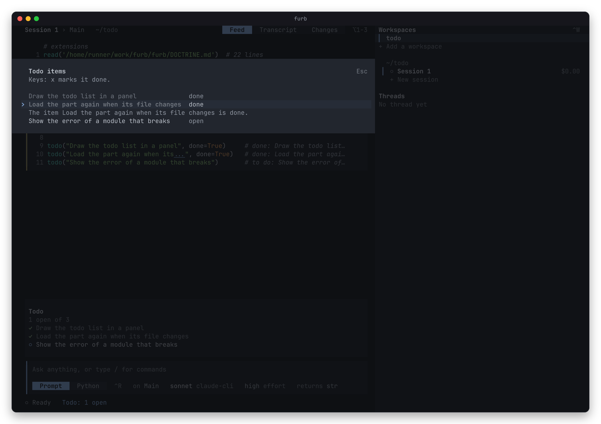

# Extensions

An extension adds to what a model can do in furb. It is Python, as a word of a model is: a life runs the word of each
extension on each chain where it plays, before any other word, so the functions that it defines are there for the model, and the
model reads the extension in its turns as it reads its own work.

An extension never goes into the system prompt. So a chain that takes one only grows at its end, and what a provider
caches of the chain stays valid.

## The official extensions

Seven extensions come with furb, and each life runs them unless a config turns them off.

- **`catchup`** keeps a chain up to date with the machine. At each stand, as when a later life opens on a record, it
  reads again each file that the chain read or wrote, and tells the chain in one paragraph headed caught up the lines
  that changed, and the hours since the life before when they are more than one. Its life word is `catchup()`. A
  chain where nothing changed hears nothing.
- **`memory`** tells a chain the memory files of its project. The memory of a folder is its `AGENTS.md`, or its
  `CLAUDE.md` when it has no `AGENTS.md`. When a chain starts, it reads the memory of the user, in the config
  directory, then the memory of each folder from the root down to the working directory. Each time the chain reads a
  file in a folder below, it reads the memory of each folder on the way. A memory file comes whole the first time,
  and again only when it changed. Its life word, `await recall()`, reads each memory file in the setup of the
  root, which every new chain holds, and then `remember()` does the rest as the chain works.
  `memory(path)` tells the memory of one path.
- **`skills`** gives a chain the skills that it can read. `skills()` lists each skill that it finds in `.furb/skills`,
  `.agents/skills` and `.claude/skills` of the working directory and of each folder above it, then in `skills` of the config
  directory. `skill(name)` reads the `SKILL.md` of one skill. Its life word, `await listed()`, reads `skills://` in the
  setup of the root, which every new chain holds. It carries one skill of its own, `extending`, which shows a model how to extend furb, with an
  example for each way. A skill named `extending` in a folder takes its place.
- **`compaction`** cuts a chain to the work that it still needs, and the chain goes on under its name, since a
  compaction in furb is a prefix said on the chain, which takes the place of its transcript. `supersede(keep)` says
  that prefix: what the filter kept, all that made it, and every act. `compact()` supersedes the chain of the caller:
  its filter applies `FILTERS` in order, and its next word binds the summary that it is given and reads again with
  `reground()` each file that it kept a read or write of, and shows only what changed. `latest()` keeps the last read
  or write of each path, `quiet()` drops the commands, `recent(n)` keeps the acts of the last `n` replies,
  `await chosen()` asks a model which acts to keep, and `together(*filters)` joins filters. `choice()` asks a model,
  on a chain of its own, which acts the work still needs and what the rest holds, and `await condense()` asks it and
  compacts the chain at once to what the model chose, with its summary. `compacted()` watches one chain:
  after an answer that fills more than `SHARE`, 0.6, of the window of its model, it asks `choice()`, and at the next
  reply after the answer, it compacts the chain to what the model chose, with its summary. It moves, stops and pauses
  nothing, so a loop such as `while True: await conduct()` goes on with its state, and the workers that a conductor
  hired go on. `imported(record, source)` makes a chain that goes on from the chain `source`, `chain1` by default, of
  another record: a rung of the new chain awaits `inherit(record, source)`, which awaits `carry(record, source)`. The
  ear of the World reads that record with no life and answers with the turns of that chain and its open prompts, and
  the record of this life keeps the answer, so a later life opens no other file. `inherit` says the carried turns as
  the prefix of the chain, opens each carried prompt again under a new name, and tells what it carried. Each value of
  the module, each word that ran and each command that was open there is lost, since it ended with the life that ran
  it, and a record whose log does not agree with it gives its replies and no tell. No chain is watched unless a word
  asks for it, so the extension has no life word. A project changes
  the defaults in an extension of its own whose word rebinds `SHARE`, `FILTERS`, `CHOOSER`, `LISTED` or `BRIEF`.
  Its part for the TUI marks each compaction in the feed of the chain: a rule at its place, with its summary under
  it, which parts what the model no longer reads from what it reads now. Its command `/compact` runs
  `await condense()` on the chain on screen: the footer says that a model compacts the chain, and the rule shows the
  summary once the model chose. The board of the chains says how many
  times a chain compacted. A chain that an older compaction made, which went on in a new chain whose first word
  restores its source, shows with that source as one chain, named `Main -> compacted`, with one feed.
- **`ouroboros`** teaches a model to extend furb. Its file holds the lore, which every chain reads in the setup, so
  it has no life word. The lore says the three ways to extend furb and when to take each: a def in a word, which lives with its chain; `extend(name, *rungs)`, which
  writes the words of those rungs as an extension of the project and turns it on, so every later chain runs it; and
  an official extension, which lives in furb. `extend(name, *rungs, tui=module)` also writes a
  [part for the TUI](#a-part-for-the-tui). `enabled()` gives the extensions that the life runs.
- **`web`** searches the web and reads its pages. `web_search(query)` uses the search of the provider of the model of
  the chain, or of the actor that `to` names: the tool WebSearch of the claude command line, the web search of the
  APIs of Anthropic, OpenAI and xAI, Gemini grounded in Google Search, and the search of DeepSeek. For a provider with
  no search, it uses the free search of Parallel for agents, which needs no key. `web_fetch(url)` reads a page, as
  Markdown when it is HTML. Each is an act to await, as a command is, since a page takes seconds. The extension has no
  life word.
- **`mcp`** connects the chain to the servers of the Model Context Protocol, as Claude Code does. A server comes from
  three configs, and the later wins for a name: `mcp.json` in the config directory of the user, `.mcp.json` of the
  project, which has the form of Claude Code, and `.furb/mcp.json`. Each holds `{"mcpServers": {name: server}}`: a
  command, its `args`, `env` and `cwd` for a server over stdio, or a `type` of `http` or `sse` with a `url` and
  `headers` for a remote one. `${VAR}` and `${VAR:-default}` expand in each of them, `"timeout"` bounds a call in
  seconds, `"deny"` hides tools, and `"disabled": true` turns a server off. A server of `.mcp.json` runs only once the
  operator approves it. The ear of the World connects each server, ends each server over stdio with the life, connects
  a lost server again with a backoff, and signs in to a remote server with OAuth 2.1 when it asks for a login: the
  token stays in the Keychain on macOS, else in a file that only the user reads. Its life word, `await mcp_index()`, tells
  each chain one line for each server, with its state and its tools, and binds the tools of each short server as a
  class of typed functions, so a model writes `await github.create_issue(owner="o", repo="r", title="t")` and the gate
  checks each argument before the call. `mcp_use(server)` binds a larger server, `mcp_tools(server)` and
  `mcp_tool(server, name)` tell signatures and schemas, `mcp_call(server, tool, arguments)` calls a tool by its
  original names, `mcp_read(server, uri)` reads a resource, `mcp_prompt(server, name, arguments)` expands a prompt,
  and `mcp_control(action, server)` reconnects, enables, disables, approves, logs in or logs out. Each answer of a
  server stays in the record, so a later life asks no server again. Its part for the TUI gives `/mcp`, a dialog of the
  servers and their actions, a command for each prompt of a server, a status in the footer, a row for each call of a
  tool, and `@` in the input, which completes the resources of the servers.

`compaction`, `web` and `mcp` each hold a short guide for the model, a quote named after the extension, which the model reads
on each chain.

## Turn an extension on or off

Two configs say which extensions a life runs: `config.json` in the config directory of the user, then
`.furb/config.json` in the directory of the project. The project wins for a name. The config directory is
`FURB_CONFIG_DIR`, else `furb` under `XDG_CONFIG_HOME`, else `furb` under `~/.config`, or under `%APPDATA%` on
Windows.

```json
{ "extensions": { "memory": true, "skills": false, "notes": "~/src/furb-notes" } }
```

- `true` turns an extension on, and keeps the path that an earlier config gave.
- `false` turns an extension off.
- A path turns on the extension in that folder. A relative path starts at the folder of the config, and `~` is your
  home.

A config of another form, a folder with no manifest, a manifest of another name, and a missing word are each refused
with their path. The `.furb` of a project keeps all that it holds out of version control but `config.json` and
`extensions/`, since the extensions of a project are code of the project, which its team shares.

`furb extensions` prints the extensions that a life here runs, and `/extensions` lists them in the TUI.

## Write your own

The smallest extension is a function that a model wrote in a word. When a later chain needs it too, a model calls
`extend(name, ...)` of `ouroboros`, which writes the extension for you. You can also write one by hand: an extension
is a folder.

```
.furb/extensions/<name>/
  furb.json     the manifest
  <name>.py     the word
  tui.ts        the part for the TUI, which it can have
```

The manifest is a JSON map:

```json
{ "name": "notes", "word": "notes.py", "life": "notes()", "plays": "every", "tui": "tui.ts" }
```

- `name` is the name of the extension: a lower case letter, then lower case letters, digits and `-`. It must be the
  key that the config gives it.
- `word` is the file of the word, relative to the folder. It is a Python module that imports what it uses from
  `furb.engine`, so an editor, ruff and ty read it. The word that a chain runs is that file less its imports of furb.
  It only defines: it holds no comment and binds no name of the engine. It can hold one quote of guidance for the
  model, which holds no law.
- `life` is the life word, a line of Python that starts the work of the extension, such as `await recall()`. It
  awaits each act that it starts whose first answer comes later, as `await mcp_index()` does, so what that act tells
  stands in the turn of the life words of the setup. It can be absent.
- `plays` says where the extension plays: `"every"`, on every chain, which is the default, or `"root"`, on the root
  chain alone. A chain with a source keeps what its source played, so a chain that goes on from the root has an
  extension of the root, and a new chain with no source has none. Give `"root"` to an extension whose names only the
  work of the root needs, as a loop that conducts workers: each other chain then reads none of its words, and a model
  there is free to bind each name that it defines.
- `tui` is the file of the [part for the TUI](#a-part-for-the-tui). It can be absent.

A word reaches the machine only through the acts that furb has already: a read, a write, a command, a wait, the
clock, a chance, and a prompt to the operator. It can also make acts that an ear of its own answers, written in
Python, as `remember()` does, and answer the reads of a scheme of its own. An extension that needs an ear in Rust is
a change of furb. The skill `extending` gives an example of each.

An official extension also has a contract, `<name>.pyi`, whose laws its suite in `test/` holds, as
[the hygiene laws](../AGENTS.md#the-hygiene-laws) say, and an ear of the World in `src/extension/<name>.rs` when it
reads the disk or the network, as `memory`, `skills` and `web` do. Its part for the TUI, `tui.ts` beside its word as
`compaction` has, is in the crate, so the TUI loads it from an installed package too, where no checkout of furb
stands. It changes with a build of furb, and not live.

Turn on only the extensions that you trust. A word runs in the sandbox of monty with the engine of the crate, and with
the rights of your user with the engine of CPython, as a word of a model does there.

## A part for the TUI

An extension can give the TUI a part: a module of TypeScript, which its manifest names under `tui`. A part can add a
panel over the input, a row in the feed for each act of a kind, keys, and commands. Nothing builds it: Bun loads the
module as it stands, and loads it again when it changes, with no restart.


The module exports a function as its default, which the TUI calls with `furb`:

```ts
export default function (furb) {
  const items = (seen) => seen.of("todo").map((act) => ({ item: String(act.words[0]), done: Boolean(act.words[1]) }));
  furb.panel("Todo", (seen) => items(seen).map(({ item, done }) => [[done ? "✓ " : "○ ", "accent"], [item]]));
  furb.row("todo", (act) => ({ label: String(act.words[0]) }));
  furb.command("todos", "Say how many items are open", (_, seen) => seen.say(`${items(seen).length} items`));
}
```

- `furb.panel(title, draw)` adds a panel over the input while the feed shows. `draw(seen)` gives its lines, each a
  text or a list of `[text, tone]`, where a tone is `text`, `muted`, `faint`, `accent`, `success`, `warning` or
  `danger`. The TUI draws it again each time that the life changes, and shows twelve lines at most.
- `furb.row(kind, draw)` draws each act of a kind in the feed: `draw(act, seen)` gives `{ label, details }`, the
  hint at the end of the line of the program that made the act, and the lines that show under that line when a click
  opens it. The rows of a rung and of a prompt stay the TUI's own.
- `furb.mark(draw)` marks places in the feed of a chain: `draw(seen)` gives a list of `{ chain, at, title, lines }`.
  The feed of that chain shows each mark as a rule with its title, then its lines, after the last act that began
  before `at`, or at its start. `at` is a place in time, as the `began` of an act, so a mark stands between the acts
  before it and the acts after it. When the feed shows a moment of the past, it shows only the marks before that
  moment. A mark that throws shows its error as its title.
- `furb.key(on, run)` adds a key, as `ctrl+e` or `+`, which acts while no dialog is open. A key with no ctrl, meta or
  alt acts only on an empty input.
- `furb.command(name, detail, run)` adds a command to the palette, which `/name` runs too. A key of the TUI wins over
  a key of a part, and a part that names a command of the TUI fails.
- `furb.commands(draw)` gives commands from the life: `draw(seen)` gives a list of `{ name, detail, run }`, which the
  palette, the suggestions of the input and `/name` read again at each use. So a part adds and drops commands as the
  life changes, as the part of `mcp` gives a command for each prompt of each server that is connected. A command that
  the TUI or a part names already wins, and a listed command whose name holds a space or a slash is dropped. A list
  that throws shows its error in the palette.
- `furb.complete(trigger, list)` completes a word of a message that starts with the trigger, one sign as `@` or `#`:
  `list(text, seen)` gives `{ label, detail, text }` for the text after the trigger, and a completion that the
  operator takes puts its `text` in the place of the trigger and of the text after it. `/` and `:` are the TUI's own,
  and after `@`, the completions of the parts come before the files of the project. A list that throws shows its
  error under the input.
- `furb.status(draw)` adds a status to the footer: `draw(seen)` gives a line, which shows after the state of the
  session only when it is not empty. A status that throws shows its error in its place.
- `seen` gives the chain on screen, every act of the life, `compactions`, each compaction of a chain as the model of
  a life gives it, and `of(kind)` for the acts of a kind. It acts in the life too, and each of its acts goes through
  the record:
  - `run(word)` runs Python on the chain through the gate, as `/run` does, and gives the value of the last act that
    the word made on the chain, once that act is done, as the record holds it. A word that makes no act gives
    `undefined`, and a word that raises or that the gate refuses rejects with its error. So a part that needs a value
    gets it from an act of its extension, which the record keeps, as `await seen.run('mcp_control("reconnect", "x")')`.
  - `send(text)` sends a message of the operator to the chain on screen, as Enter sends the input, and
    `draft(text)` puts a text in the input, for the operator to change and send.
  - `open(url)` opens an address of http or https in the browser of the system, and rejects any other address.
  - `say(text)` shows a notice in the footer.
  - `choose(title, items, { note, actions, selected })` opens a list and gives what the operator chose, as
    `{ value, action }`. Each item has a `label`, a `detail`, a `tone`, the `lines` that show under it while it is
    selected, and its `value`. Enter gives the selected item with the action `""`, and the key of an action, as
    `{ key: "r", label: "reconnect" }`, gives the item with that key. A key that types a sign acts only while the
    filter of the list is empty.
  - `form(title, fields, { note })` opens a form and gives the value of each field by its name. A field has a
    `name`, a `label`, a `detail`, a `value` that it starts with, and can be `secret`, which shows a dot for each
    sign, or `required`. Tab and Enter go to the next field, and Enter on the last one sends the form, which stays
    open while a field that it needs is empty.
  - `confirm(title, text, { yes, no })` asks a question and gives `true` for yes.

  A dialog that Escape closes, or that another dialog replaces, gives `undefined`, or `false` for a confirm. A key or a
  command whose run awaits a dialog keeps the TUI free while the dialog is open.
  `furb.life` is [the model of a life](../bind/typescript/README.md), `furb/life`.

A part imports types alone, so it loads in any project. `tui/src/parts.ts` gives the types, and `tui/fixtures/todo`
is an extension with a part that uses each of them. The part of `mcp`, `extensions/mcp/tui.ts`, uses only this API.



The TUI loads the parts when it opens a session, and again when a file of the folder of
a part changes, or when a write of the life lands in `.furb` or in the folder of a part, as a write of `extend` does.
It loads them also for a life that enables no extension, such as the demo, since a part reads only the acts of the
life.

When a part fails, the TUI goes on. A module that does not load, that exports no function, or whose function throws
shows its error in plain words in a panel under its name. A panel or a row that throws shows its error in its place,
and a key or a command that throws shows its error in the footer.

A model adds a part to a life that runs with `extend(name, *rungs, tui=module)` of `ouroboros`, which the skill
`extending` teaches. The write lands in `.furb`, so the TUI loads the part at once. The config turns the extension on in
the same life. A config that sets the extension to `false` takes its part away again. `/extensions` opens a dialog of
the extensions that the life runs, each with what its part gives, or with the error that stopped its load. Only the
operator sees an error of a part, so the skill tells the model to check its module with `bun build --no-bundle` and to
read the error that the operator gives it.

## Permissions

furb has no permissions, by design. Each act runs with the rights of the user who runs furb, and the record shows who
made each act. For isolation, run furb in a virtual machine.

An extension can add a check: its word can define a verb again, such as `bash`, so that the verb asks you before it
makes the act. A word of the model can define that verb again too, so such a check stops a mistake and not an
attack. furb has no such extension built in.

## How a life runs its extensions

A life enables each extension by a fact, `enable`, which the record keeps, so a later life on the record runs the
same words. [`src/furb/AGENTS.md`](../src/furb/AGENTS.md) says what the fact means and when a life says it, and the
ear `extensions` of [`src/extension.rs`](../src/extension.rs) says the fact and plays it.

The extensions that a life enables at its start are those that the configs turn on. When a write of
`.furb/config.json` lands in the middle of a life, the life enables each extension that the config turns on by its
path and that it does not run yet. An extension that a config turns off runs on until the life ends.

A life reloads an extension that it runs when its word changes: at its start, or at a later stand, for the word that
the host gives, as a new build gives a new word of an official extension, and when a write of the life lands in the
folder of an extension that a config turns on, as `extend()` does. The life enables it again with the new word, and
each chain plays the definitions of that word: its imports, its functions, its classes, its types and its
names in capitals, and each name of state that it assigns, as `queue: list = []`, in file order. So a function and a
constant take their new value, a new name of state takes its first value, a name of state that the chain holds, such
as `queue`, keeps its value, and the life word does not run again. A change of a file that no write of the life makes reaches the life at its
next start. A host that gives no extensions, as the DeepSWE rig does,
enables none.

Each thing that comes from the disk reaches a chain through a question that an ear of the World answers, and a later
life gets the same answer from the record. So a replay is exact, and the World is asked nothing twice.

## In each host

- The command line: `furb extensions` prints each extension that a life on a record runs, with its life word. The
  `state` of the JSON-RPC names them.
- The TUI: `/extensions` lists what the life runs, and `/run` runs a word of one on the chain on screen, as
  `/run skill("pdf")`.
- TypeScript: `Session` takes `extensions`, false to enable nothing new, and `config`, the config directory of the
  user.
- Both doors: `opened` gives the record and the ears of the crate, and `extensions` false enables nothing new.
  `enabled`, on the facts of the root, gives the extensions that a life runs, in the order that it enabled them.
