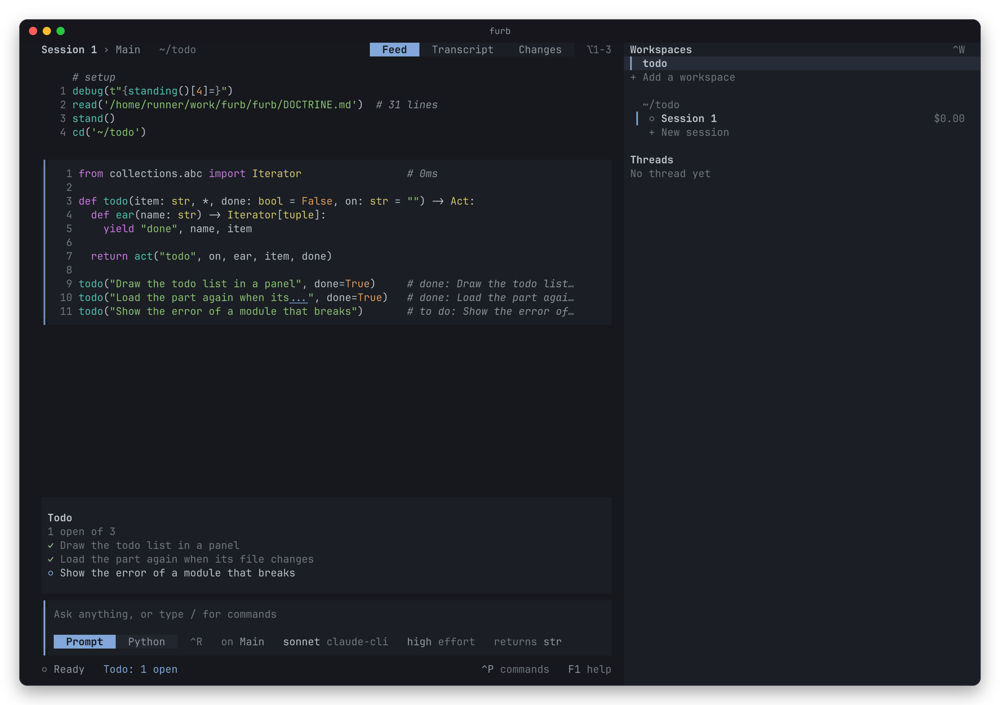

# Extensions

An extension is python that extends the engine, as a word of a model can. A life plays the word of each extension
that it runs as a rung on each chain, so the model reads the word in its turns, and the names it defines are bound in
the module of the chain. An extension never enters the system prompt or the module of the engine, so a chain that
takes one grows at its end, and what a provider caches of it stands.

## What an extension is

An extension is a folder:

```
extensions/<name>/
  furb.json     the manifest
  <name>.py     the word
  <name>.pyi    the contract, which an official extension has
  test/         the suite, which an official extension has
  tui.ts        the part for the TUI, which an extension can have
```

The manifest is a JSON map with four keys:

```json
{ "name": "memory", "word": "memory.py", "life": "remember()" }
```

- `name` is the name of the extension: a lower case letter, then lower case letters, digits and `-`. A config names
  the extension by it, and the name must be the key of the config.
- `word` is the file of the word, relative to the folder. It is a python module that imports what it uses from
  `furb.engine`, so an editor, ruff and ty read it. The word is that file less its imports of furb, with its line
  ends made LF. It only defines, holds no comment, and binds no name of the engine. It holds no sentence but one
  doctrine of its own, a quote that holds no law, as furb holds its own in `DOCTRINE.md`. Its contract holds its laws, as
  `engine.pyi` holds those of the engine.
- `life` is the life word, python that starts the work of the extension, such as `remember()`. It can be absent.
- `tui` is the file of the part for the TUI, relative to the folder: a module of TypeScript, which the TUI loads beside
  the life, as [A part for the TUI](#a-part-for-the-tui) says. It can be absent, and an official extension has none.

## Where furb finds extensions

Two configs say which extensions a life runs: `config.json` in the config directory of the user, then
`.furb/config.json` in the directory of the life, so the project wins for a name. The config directory is
`FURB_CONFIG_DIR`, else `furb` under `XDG_CONFIG_HOME`, under `%APPDATA%` on Windows, or under `~/.config`. The
`.furb` that a host makes keeps all it holds out of version control but `config.json` and `extensions/`, since the
extensions of a project are code of the project, so a project can share them.

```json
{ "extensions": { "memory": true, "skills": false, "notes": "~/src/furb-notes" } }
```

- `true` turns an extension on, and keeps the path that an earlier config gave.
- `false` turns an extension off.
- A path gives the folder of an extension that is not official. A relative path starts at the folder of the config,
  and `~` is the home.

The official extensions, `memory`, `skills`, `compaction`, `ouroboros` and `web`, are on unless a config turns them off. A config that is not of this
form, a folder with no manifest, a manifest of another name, and a missing word are each refused with the path.

## How a life runs its extensions

A life enables each extension by a fact, `enable`, which the record keeps. [`src/furb/CLAUDE.md`](../src/furb/CLAUDE.md)
says what the fact means and when a life says it, under the names enable and life word and in its laws.
The ear `extensions` of [`src/extension.rs`](../src/extension.rs) says the fact and plays it, and its documentation
gives the shape of the fact. The extensions that a host gives the ear are those that the configs turn on. In the
middle of a life, when a write of `.furb/config.json` in the directory of the life lands, the ear enables each
extension that the config turns on by its path and that the life does not run, with the same fact. A word that
the life runs already does not change in that life, and an extension that a config turns off runs on. A host
that turns the extensions off, as the DeepSWE rig does, gives the ear none.

Anything that comes from the disk reaches a chain through a question that an ear of the World answers, which the
journal answers again in a later life, so a replay is exact and the World is asked nothing twice.

## The official extensions

- `skills` defines `counted()`, which tells in one line how many skills the chain knows and that `skills()` lists
  them, and `skills()`, which reads `skills://`: one line for each skill that the World finds in
  `.furb/skills` and `.claude/skills` of the working directory of the chain and of each folder above it, then in
  `skills` of the config directory. `skill(name)` reads the `SKILL.md` file of a skill. It carries one skill of its own, `extending`, which a
  skill of that name in a folder replaces: it shows a model, with an example each, how to extend furb by a def in a
  word and by an extension, and it points to this guide for the rest. Its life word is `counted()`.
- `memory` defines `memory(path)`, which tells the chain the memory files that apply to a path: the memory of the
  user, in the config directory, then that of each folder from the root down to the working directory of the chain,
  then that of each folder under it down to the folder of the path, when the path is under it. The memory of a
  folder is its `CLAUDE.md`, or its `AGENTS.md` when the folder holds no `CLAUDE.md`. A memory file enters the chain
  whole the first time, and after that again whole, only when it changed. `remember()`
  is an act that tells the memory of the working directory when it is made, then the memory of the folder of each
  file that the chain reads, and the memory that changed at each stand. Its life word is `remember()`.

- `ouroboros` teaches a model to extend furb. Its life word, `ouroboros()`, tells each chain its doctrine once: the
  three ways to extend furb and when to take each. A def in a word lives with its chain. `extend(name, *rungs)` lives
  with the project: it writes the words of those rungs, as `program()` holds them, as the word of the extension
  `name` in `.furb/extensions/<name>`, with its manifest, and turns it on in `.furb/config.json`, so it plays on
  every chain now and in every later life. `extend(name, *rungs, tui=module)` also writes `module` as `tui.ts`, the
  part of the extension for the TUI, and the manifest names it. An official extension lives in furb. `enabled()` gives the names of the
  extensions that the life runs. It needs no ear of the World.

- `compaction` is a kit to go on in a new chain that keeps less of the old one, since in furb a compaction is a
  chain with a source and a filter. `compact()` makes that chain from the chain of the caller: its filter applies
  `FILTERS` in order, and its first word binds again what the module of the old chain holds with `restore(source)`,
  binds the summary that it is given, and reads again with `reground()` each file that it kept a read or write of,
  showing only what changed. Each filter is a small function that gives a filter: `latest()` keeps the last read or
  write of each path, `quiet()` drops the commands, `recent(n)` keeps the acts of the last `n` replies, and
  `await chosen()` asks a model which acts to keep. `together(*filters)` applies filters in order. `choice()` asks a
  model, on a chain of its own, which acts the work still needs and what the rest holds: its prompt lists each open
  prompt and each act, with the size of its text, each act of a step under that step. `compacted()` wraps one chain:
  after an answer that reads more than `SHARE`, 0.6, of the window of its actor, it asks `choice()`, and at the next
  reply once that came, it compacts the chain to what the model chose, with its summary, moves each open prompt of a
  model to the new chain, and wraps that chain. It stops each open rung of a prompt that it moves with a close, which
  reaches that rung alone, and it pauses nothing, so the workers that a conductor hired go on; the summary names each
  rung that it stopped, and the module of the new chain holds what the module of the old one held, so a loop such as
  `while True: await conduct()` runs again once, on that state. No chain is wrapped unless a word wraps it, so the
  extension has no life word and needs no ear of the World. A project changes the defaults in an extension of its
  own whose word rebinds `SHARE`, `FILTERS`, `CHOOSER`, `LISTED`, `BRIEF` or `LABEL`. Its doctrine, the quote
  `compaction`, says each part in a few words.

- `web` searches the web and reads its pages. `web_search(query)` is an act that the World answers with the native
  search of the provider of the actor of the chain, or of the actor that `to` names: the claude command line with its
  tool WebSearch alone, the web search of the Messages API of Anthropic and of the Responses API of OpenAI and of
  xAI, Gemini grounded in Google Search, and the search API of DeepSeek. For a provider that has no native search,
  the World uses the free search of Parallel for agents, which needs no key. `web_fetch(url)` is an act that the
  World answers with the page at that address, in Markdown when the page is HTML. Each is an act of a text to await,
  as a command is, and not a read, since a read gives its value at once and a page takes seconds. Each tells its
  text with its show when it is done. The extension has no life word. Its doctrine, the quote `web`, says each part
  in a few words.

Each has a contract, `extensions/<name>/<name>.pyi`, which the hygiene laws 1 to 4 of `CLAUDE.md` hold to its suite
as they hold the engine. Laws 5 to 7 are for `engine.py` alone, and laws 8 and 9 hold the word of each extension.
`memory`, `skills` and `web` also have an ear of the World in the crate, `src/extension/<name>.rs`, which answers
their questions from the disk, or from the network for `web`. The suite runs on both engines.

## A third party extension

A third party extension has a word and a life word, and no ear of its own. The skill `extending` gives an example
of one. Its word reaches the machine through the
acts that the World takes already: a read, a write, a command, a wait, the clock, a chance, and a prompt to the
operator. It can also make acts with ears of its own, written in python, as `remember` does, and a door that
answers the reads of a scheme of its own. An extension that needs an ear in rust is a change of the crate.

Name only the extensions that you trust. A word runs in the sandbox of monty on the engine of the crate, and with the
rights of the user on the engine of CPython, as a word of a model does there.

## A part for the TUI

An extension can give the TUI a part: a module of TypeScript, which its manifest names under `tui`. The part draws on
the model of a life and on the acts of the extension. Nothing builds it: Bun loads the module as it stands.

- When the TUI opens a session, it loads the part of each extension that the configs turn on, as `parts(project)` of
  the binding gives them from the configs and the manifests as they are then. It loads the parts again when a file of
  the folder of a part changes, and when a write of the life in `.furb` of the project or in the folder of a part
  lands, as a write of `extend` does. A part needs no restart and no build of furb.
- The module exports a function as its default, which the TUI calls with `furb`, as Pi gives the API of the agent to
  an extension. The function calls `furb.panel(title, draw)`, `furb.row(kind, draw)`, `furb.key(on, run)` and
  `furb.command(name, detail, run)`.
- A panel stands over the input while the feed shows. `draw(seen)` gives its lines, each a text or a list of
  `[text, tone]`, where a tone is `text`, `muted`, `faint`, `accent`, `success`, `warning` or `danger`. The TUI draws it
  again each time that the life changes. A panel shows twelve lines at most.
- A row draws each act of its kind in the feed: `draw(act, seen)` gives `{ label, details }`, the text after the kind
  and the lines that its card shows when it opens. The rows of a rung and of a prompt are the TUI's own.
- A key, as `ctrl+e` or `+`, acts while no dialog is open, and a key with no ctrl, meta or alt acts on an empty input
  alone. A command runs from the palette, or as `/name` in the input. A key of the TUI wins over a key of a part, and a
  part that names a command of the TUI fails.
- `seen` gives the chain on screen, every act of the life, `of(kind)` for the acts of a kind, `run(word)`, which runs
  python on the chain through the gate as `/run` does, and `say(text)`, which shows a notice in the footer.
  `furb.life` is the model of a life, `@furb/engine/life`.
- A part imports types alone, so it loads in any project. `tui/src/parts.ts` gives the types, and `tui/fixtures/todo`
  is an extension with a part.
- A module that does not load, that exports no function as its default, or whose function throws, shows its error in
  plain words in a panel under the name of its extension. A panel or a row that throws shows its error in its place,
  and a key or a command that throws shows its error in the footer. The TUI goes on in each case.
- The TUI loads the parts that the configs turn on also for a life that enables no extension, such as the demo, since
  a part reads only the acts of the life.

```ts
export default function (furb) {
  const items = (seen) => seen.of("todo").map((act) => ({ item: String(act.words[0]), done: Boolean(act.words[1]) }));
  furb.panel("Todo", (seen) => items(seen).map(({ item, done }) => [[done ? "✓ " : "○ ", "accent"], [item]]));
  furb.row("todo", (act) => ({ label: String(act.words[0]) }));
  furb.command("todos", "Say how many items are open", (_, seen) => seen.say(`${items(seen).length} items`));
}
```



## Permissions

furb has no permissions, by design. Each act runs with the rights of the user who runs furb, and the record shows who
made each act. For isolation, run furb in a virtual machine. An extension can add a check: its word can rebind a verb,
such as `bash`, so that the verb asks the operator before it makes the act. A word of the model can rebind that verb
again, so such a check stops a mistake and not an attack. furb has no such extension built in. The extensions of
a project in `.furb/extensions`, as `extend` writes them, run with the rights of the user who runs furb, with no
permission, as the rest of furb does.

## In the hosts

- `furb extensions` prints each extension that a life on a record runs, with its life word, and the state of the
  JSON-RPC names them.
- The TUI loads the part of each extension for the TUI, as [A part for the TUI](#a-part-for-the-tui) says.
  `/extensions` lists what the life runs, and `/run` runs a word of one on the chain on screen.
- `Session` takes `extensions`, false to enable nothing new, and `config`, the config directory of the user.
- `opened` gives the record and the ears of the crate to a host of either door, and `extensions` false enables
  nothing new.
- `enabled`, on the facts of the root, gives the extensions that a life runs, in the order it enabled them, in either
  door.
