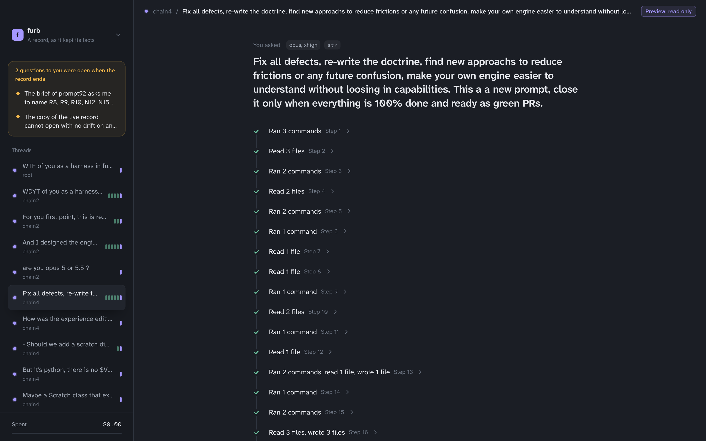
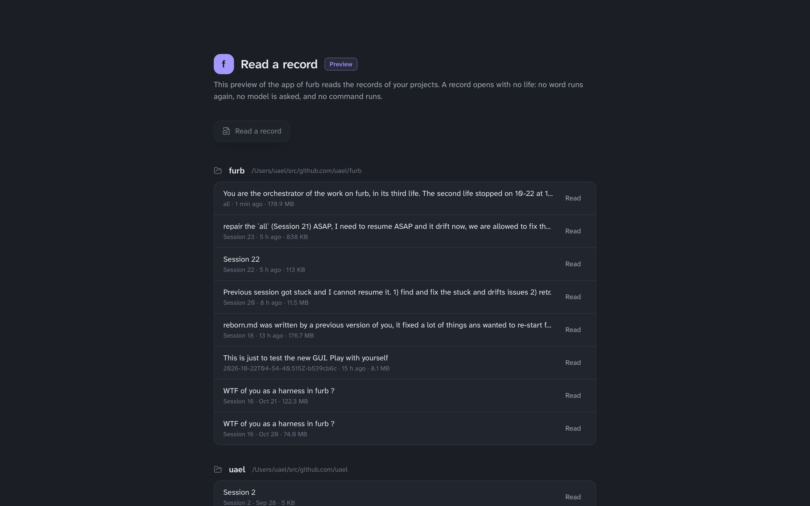

# furb preview

The desktop app of furb, as a preview: it reads the records of furb in a window. Pick a record of a project, and read
each thread from top to bottom, with each step that its model took, the threads that a step asked, and the answer.

The preview only reads. It runs no word again, asks no model, and runs no command, so it is safe to open any record,
also a large one or one that an earlier engine made. The title of its window and each of its screens say so.



## What you need

- A clone of this repository, and the tools of [the developer guide](../docs/developer-guide.md#what-you-need): Rust and Bun.
- The web view of your system. macOS has it. Windows 10 and 11 have WebView2. Linux needs WebKitGTK and the other
  libraries of the [prerequisites of Tauri](https://v2.tauri.app/start/prerequisites/).

The app is proved on macOS. It builds for Windows and Linux too, but no gate runs it there yet.

## Build it and start it

From the root of the clone:

```sh
bun install                          # The packages of the UI, with the rest of the workspace.
cd gui
bun run tauri build --debug          # The UI, then the app. The first build takes some minutes.
../target/debug/furb-gui             # Start it.
```

The build writes the program `furb-gui` in `target/debug` at the root of the clone, and on macOS the app
`target/debug/bundle/macos/furb preview.app` too, which you can open with a double click or move to Applications.
The debug build optimizes each dependency, so it reads a record as fast as a release. `bun run tauri build`, with no
`--debug`, makes the release in `target/release`.

To change the app, run `bun run tauri dev` in `gui`. It starts the UI on a server of its own and the app on it, and
shows each change of the UI at once. Give the app its words after `-- --`, as
`bun run tauri dev -- -- --record path/to/session.jsonl`.

## Open a record

The app opens on the picker. It lists the projects that the TUI knows, each with the records in its
`.furb/sessions`, the newest first. Click a record to read it, or click **Read a record** to choose any file with the
dialog of your system.



You can also give the record when you start the app:

```sh
furb-gui --record path/to/session.jsonl
```

Two more words help a script or a test:

- `--check` ends the app once its window drew the whole record, and prints how many chains, threads and acts it
  drew.
- `--view PATH` reads the record that `--record` names with no window, and writes it to `PATH` as the window takes
  it. The UI shows such a file in a browser: `FURB_FIXTURE=PATH bun run dev` in `gui`, then open
  http://localhost:5174. With no `FURB_FIXTURE`, the browser shows the demo of the TUI.

## What it does not do yet

- It does not run a life: you cannot send a message, answer a question, or pause, cancel or rewind work. Use
  [the TUI](../tui/README.md) for that.
- It shows a record as it stands when you open it, and does not follow a life that still runs.
- It has no loom, no graph, and no view of the program of a chain, which the TUI has.
- No release ships it yet: build it from a clone.

[`DESIGN.md`](DESIGN.md) says how the app is made and why.
