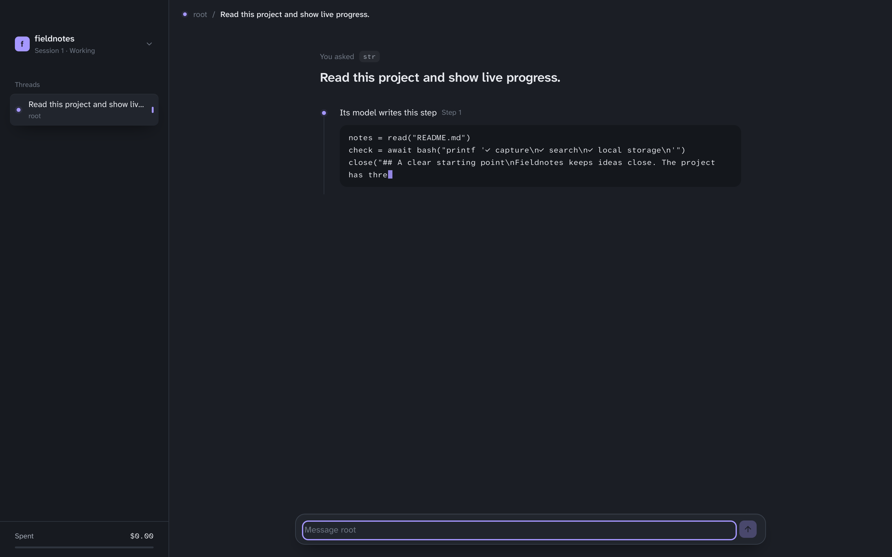
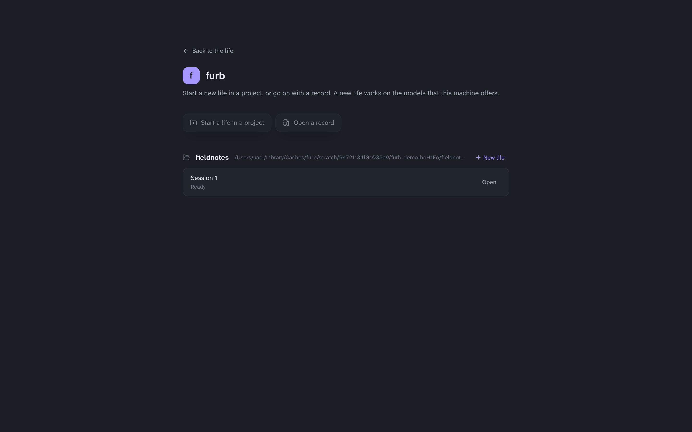
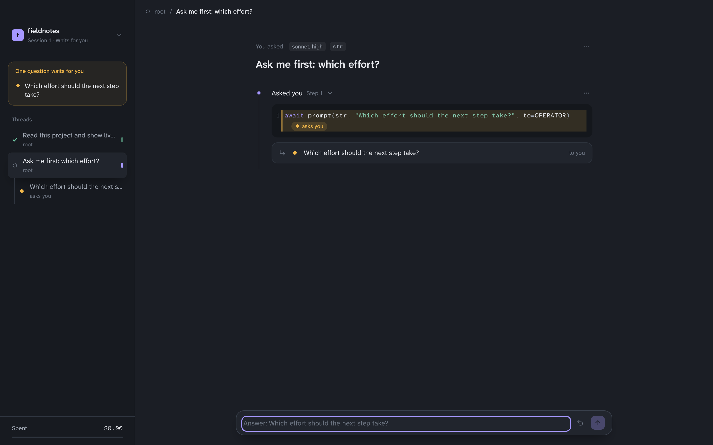
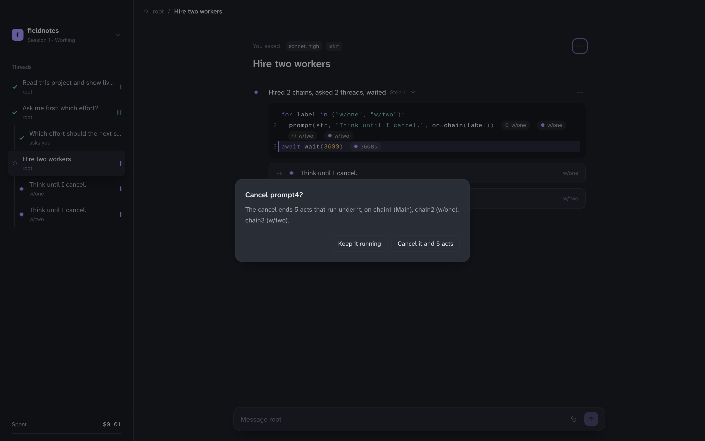
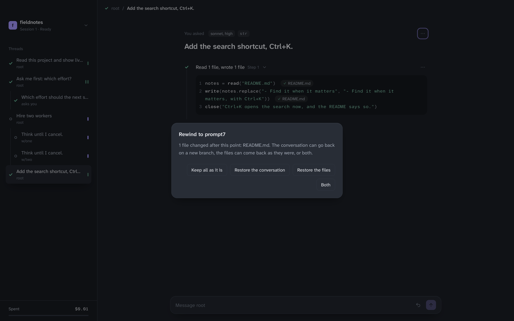

# furb, the desktop app

The desktop app of furb runs a life of furb in a window, as the TUI runs one in a terminal. Start a new life in a
project, or go on with a record. Send a message to a chain, and see each model write its step and each command print
as they work. Answer each question of a model, pause, wake or cancel the act that you pick, take back your last
message, and rewind to an earlier point with its files.



## What you need

- A clone of this repository, and the tools of [Contributing](../CONTRIBUTING.md#what-you-need): Rust and Bun 1.4.2
  or later.
- The web view of your system. macOS has it. Windows 10 and 11 have WebView2. Linux needs WebKitGTK and the other
  libraries of the [prerequisites of Tauri](https://v2.tauri.app/start/prerequisites/).

The app is proved on macOS. It builds for Windows and Linux too, but no gate runs it there yet.

## Build it and start it

From the root of the clone:

```sh
bun install                          # The packages of the UI and of the host, with the rest of the workspace.
bun run build                        # The package of the crate, which the host of a life runs on.
cd gui
bun run tauri build --debug          # The UI, then the app. The first build takes some minutes.
../target/debug/furb-gui             # Start it.
```

The build writes the program `furb-gui` in `target/debug` at the root of the clone, and on macOS the app
`target/debug/bundle/macos/furb.app` too, which you can open with a double click or move to Applications.
`bun run tauri build`, with no `--debug`, makes the release in `target/release`.

The app runs its host of a life, `gui/host/main.ts`, on bun, from the clone that it was built from. It finds bun in
`FURB_BUN`, else on PATH, else in `~/.bun/bin`, `/opt/homebrew/bin` or `/usr/local/bin`, since an app that the Finder
opens has a short PATH. `FURB_GUI_HOST` names another program of the host.

To change the app, run `bun run tauri dev` in `gui`. It starts the UI on a server of its own and the app on it, and
shows each change of the UI at once. Give the app its words after `-- --`, as `bun run tauri dev -- -- --demo`.

## Start a life

The app opens on the projects that the TUI and the app know, each with its records, the newest first. **New life**
starts a life in a project on the models that this machine offers, as the TUI does. **Open** goes on with a record as
a life. **Start a life in a project** and **Open a record** pick a folder or a record with the dialog of your system.



You can also give the app what to open when you start it:

```sh
furb-gui --cwd path/to/project         # A new life in a project.
furb-gui --record path/to/session.jsonl # A record, which goes on as a life.
furb-gui --demo                        # The demo of the TUI, which asks no model and spends nothing.
```

`--model`, `--effort` and `--roster` name the models of a new life, as the TUI takes them.

A record that another engine made opens to read, as in the TUI: no word runs again, no model is asked, no command
runs, and the composer takes no message. The rail and the bar say **Read only**.

## In a life

- The rail holds the life and what it spent, the questions that wait for you, and the tree of the threads.
- A thread shows what was asked, each step that its model took, folded to what it did and open to its code, the
  threads that a step asked, and the answer. While a model writes a step, the step shows its word as it comes, and
  while a command runs, it shows what the command prints.
- The composer at the bottom sends a message to the chain of the thread shown. Enter sends it, and Shift+Enter adds a
  line. When a question waits for you on that chain, the composer answers it, and says so. A question of `bool` or of
  a `Literal` gives a button for each of its values. A notice of a model, which asks nothing, reads as a quiet line in
  its step.
- The arrow of the composer takes back your last message on the chain: a message that runs ends and comes back to the
  composer, and a message that is done leaves a new branch of the chain without it, as the undo of the TUI does.
- The menu of a thread, of a step and of a command pauses, wakes or cancels that act alone, with what stands under it,
  and never the thread or the chain that it stands on. A cancel that ends running work asks you first, with the acts
  and the chains that it ends.
- **Rewind to** in the menu of a message or of a step makes a new branch of the chain at that point. When a write
  changed a file after that point, it asks what comes back: the conversation, the files as they were, or both. A
  change that a command made stays, and the dialog says so.







The window speaks to the host over a WebSocket on 127.0.0.1 that only a window with the token of the host opens.

## Show the UI in a browser

`bun run web` in `gui` starts a host on the demo and the dev server of the UI, and prints the address of the page,
which names the socket of the host. Give it the words of the host to show another life, as
`bun run web --record path/to/session.jsonl`.

## Prove it

- `bun run test gui` from the root: the tests of the host, which drive a life of the demo through its socket and each
  of its controls, and of the window.
- `bun run shots [directory]` in `gui`, after `bun run build`: the captures of `docs/screenshots`. It drives a life on
  the demo in WebKit, the engine of the web view of macOS: it starts the life, sends a message, captures the model as
  it writes and its answer, asks a question, answers it, cancels work that runs once it confirms, and rewinds with the
  files.
- `furb-gui --check --record RECORD` ends the app once its window drew the whole life and its stdin ended, and prints
  the process of its web view and how many chains, threads and acts it drew, of the log of the life or of what the
  record kept, so the one that runs it reads that web view after the window drew. By hand, give it `< /dev/null`. A
  check enables no extension that the record does not run, and runs as an accessory of the system, with no tile in
  the Dock, so it takes the front from no app and ends only by its own exit. `gui/src-tauri/tests/check.rs` runs it
  on a copy of the record of a life of the demo in `gui/src-tauri/tests/fixtures`, or on the record that
  `FURB_RECORD` names, which must be a copy, compares the counts with those of the log beside the record, or of
  `furb facts`, and holds the footprint of that web view under 300 MB. It runs a check in a hidden window too, as a
  window behind others. The gates run it on macOS: `cargo test --features tauri/custom-protocol` in
  `gui/src-tauri`, after `bun run build` at the root and in `gui`, and `cargo build -p furb-cli`.

## What it does not do yet

- It has no loom, no graph, and no view of the program of a chain, which the TUI has.
- No release ships it yet: build it from a clone.

[`DESIGN.md`](DESIGN.md) says how the app is made and why.
