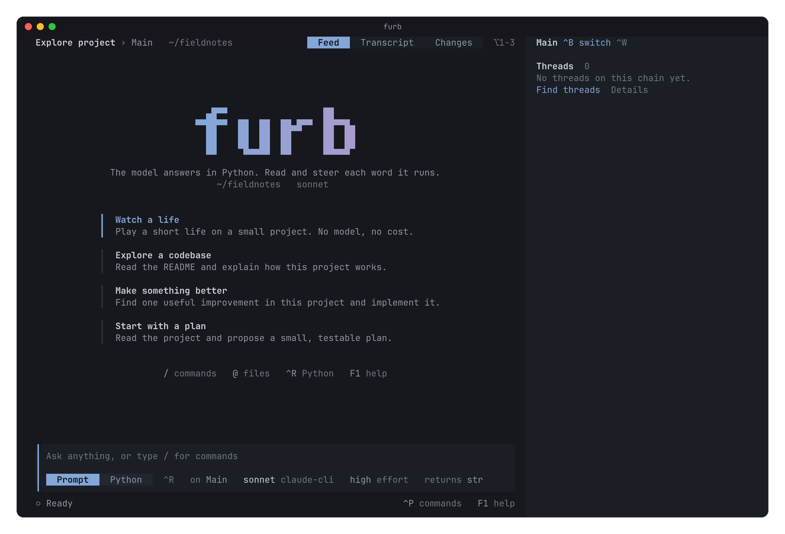

# The furb TUI

The TUI is the home of furb in a terminal. You talk to a model, watch each word that it writes run, answer its
questions, and steer the work of many chains at once. It shows the life in three views, keeps each session in a
record, and goes on with unfinished work when you open it again.



[The gallery](../docs/tui.md) shows each screen of the TUI and what it does.

## Start it

The TUI runs from a clone of this repository. It needs uv, the Rust toolchain, and Bun 1.4.2 or later. On Windows,
Bun 1.3 crashes the TUI when it calls into OpenTUI.

```sh
uv sync
bun install
bun run build
bun run demo                 # A scripted life, and a real life recorded from its log. It asks no model.
bun run tui                  # A real life, on the models of the catalog of the crate.
bun run tui -- --resume .furb/sessions/example.jsonl
```

`furb`, the command line, opens this TUI when it has no command, with `--demo`, `--record`, `--cwd`, the model and
the effort of its `--model` as `--model` and `--effort`, each `--roster`, and the words after `--`, as
[the command line](../cli/README.md) says.

The welcome of an empty chain offers "Watch a life" first: a short life on a small project that plays by itself and
asks no model, so it costs nothing. Several models answer in it, a word of Python runs as a program, and a branch
starts from an earlier point. While it plays and the input is empty, `[` and `]` move the feed back and on in time,
`b` starts a branch at the moment shown, and Esc comes back to now. `/watch` plays it too.

On the first run, and on each run while no model answers, the welcome checks the setup: the claude command line, the
keys in the environment, the local server that `FURB_LOCAL_URL` names, and the models that the catalog offers, with a
fix for each part that is missing. [Models](../docs/models.md) says how furb finds a model.

## Choose the models

`--model provider:model` and `--effort` give the default actor of a new life, and each `--roster` adds a model. With
no `--roster`, a session offers every model that the catalog offers, with its model first: the default model when you
name none. With `--roster`, it offers its model and the models of `--roster`, and no more. `--cwd` gives the
directory of the life, and `--record` its record.

`/model` and `/effort` open separate pickers. The model picker lists the models of the session, then every model that
the catalog of the crate offers. `/model name` takes `provider:model` or the id of the model alone, by the rule of the
catalog. A model of the catalog that the session does not offer joins the session: the session saves it, opens again
on its record, starts again the work that was running, but for a command, which ends as interrupted, and sends the
next prompt of the chain to that model. Each model offers the efforts that the catalog gives it, saved in the roster
of the chain. A change of model keeps the current effort if the new model offers it. A choice of a model or an effort
sets the actor of the chain by a rung of the operator. A prompt names no actor, so the next rung of a prompt that
runs, and each follow-up that the queue sends, asks the actor that the chain has then.

## Three views of a life

The TUI holds three views of the whole life side by side: the board of main, the loom of the chains in time, and the
graph of the programs that run. `--view main|loom|graph` chooses one at the start, ⌥V switches it at run time,
`/view` names one or lists the three, and the preferences keep the last one. Each view stands over the feed of the
selected chain, and every other screen stays the same in each one. ⌥G gives the keys to the loom or the graph, and
Esc gives them back. [The gallery](../docs/tui.md#views-of-the-life) shows each view, and
[`DESIGN.md`](DESIGN.md) says how they came.

## Sessions and records

Sessions are saved under `.furb/sessions` in the selected directory. The `.furb` that the TUI makes holds a
`.gitignore` that keeps it out of version control. Keep the `.jsonl`, `.session.json`, `.changes.jsonl`, and
`.ui.json` files of a session together. The last one keeps the view of the session as you left it. Keep its
`.images` directory too when the session has image attachments.

An unfinished session opens paused and offers a resume choice. The native engine replays completed work from the
record. A record whose replay drifts, as a record that a build of another version made, opens to read: the TUI shows
what the record kept, runs no word again, asks no model, and refuses each command that would change the life. A
dialog names the version of the build that made the record and the version of this build, and offers to read it or to start a new life in its
workspace. [The desktop preview](../gui/README.md) reads records in a window too.

⌃W lists the workspaces and their sessions, each with its state, save time, cost, and record size. It reads
unfinished work through native replay without locking or changing the saved record. The list shows at once, and each
saved session shows its state when its replay ends. `/workspace path` adds a folder, and `/new` starts a session in
the current workspace. `/delete` archives a chosen session, or moves it and its companions to `.furb/trash` and
removes its scratch directory from the cache of furb. The trash holds a `restore.json` with the original paths, and
its record can be opened with `--resume`, which makes again the scratch files that its words wrote.

Quit saves each open session and detaches the window from its life, and SIGINT, SIGTERM, SIGHUP, and SIGQUIT quit
the same way. On Windows, a console that closes and Ctrl+Break quit the same way. `/end` ends the life of each open
session, its commands and its models, then quits.

### A host that outlives the window

On macOS and Linux, the life of each session runs in a host of its own: a Bun process, `src/host.ts`, that holds the
record, its lease, the World, the provider, the commands and the views of the life. The window draws and attaches to
the host through a socket of Unix, so a quit or a crash of the window ends no command and no model of the life, and a
window of a new build takes the life over with its record whole.

- The host of a record listens at `hosts/<key>.sock` in the cache of furb, in a folder that only the user can open,
  where `<key>` is the key of the scratch directory of the record. Beside it, `<key>.json` says the process of the
  host, its record, its build, the engine of its life and the version of its protocol, and `<key>.log` holds what the
  host writes. When the path of the socket is too long for the system, the folder is `furb-hosts-<uid>` in the
  temporary directory.
- A window that opens a record connects to its socket. When no host answers, the window starts one, as a process of
  its own detached from the window, and waits until it listens. A host that cannot open the life, as on a record whose
  lease another process holds, ends, and the window shows why.
- Two windows can attach to one life. Each sees each change of the life, and the first answer to a question of the
  operator wins. `/end` in one window ends the life, and each other window shows that the life ended.
- When a host ends while the life goes on, as at a crash, the window starts a host again and reads the acts of the
  life again from the start.
- A window whose build is not the build of the host takes the host over. The host waits up to 10 seconds for each
  command and each reply of a model that runs, ends the life, and exits, and each other window shows that a window of
  another build took the life. Then the window starts a host of its own build, which opens the life again on the same
  record. A command that runs past the wait stays pending in the new host, and a resume ends it as interrupted, so its
  model runs it again if it wants. `FURB_BUILD` names the build of a window and of the hosts that it starts in place
  of the build of the program, as the tests do.
- The demo of a new project, which `bun run demo` opens with no `--cwd` and no record, stays in the window, since its
  folder goes when the window quits. A recorded life, which runs nothing, stays in the window too. On Windows, each
  life stays in the window.

### Many operators

One host serves one life to many operators: one record, one World, and one protocol, on this machine or over the
network. Each window that comes through the socket of Unix reads and drives the life, since only the user opens its
folder. Each other operator comes over the network, with a key that gives a role:

- `/serve [address]` opens the door of the host on the network, at `host:port` or at a port, on `127.0.0.1` and a
  free port by default, and gives two addresses: one to read and drive the life, and one to read it only. Each has the
  form `furb://host:port/key`, and each holds the key of its role. The door stays open until the host ends, and a
  later `/serve` gives the same two addresses. A host that listens at `0.0.0.0` names its machine in each address.
- `furb-tui --attach <address>`, or `furb -- --attach <address>`, opens a window on that life. The window keeps its
  view in a temporary folder, which goes when it quits, so the life of another operator joins no list of its machine.
  A quit detaches the window, and a window that writes ends the life with `/end`.
- A window that reads sees each change of the life, and the host refuses each request that would change it: a
  prompt, a word, a command, an answer, a control, a serve and an end. It opens no file of the machine of the host by
  its path, so it reads only what the life holds and the changes of its project.
- A peer of the network says its hello first, with a key, in ten seconds and in 64 KiB, or the host ends its socket.
  The host compares each key in a time that does not depend on its content.
- The door carries each message as it is, with no encryption. Over a network that you do not trust, open the door
  at `127.0.0.1` and reach it through a tunnel, as `ssh -L 7700:127.0.0.1:7700 <host>`, or through a private
  network.

A recorded life is a log of a life whose first line is a header that says `"recorded": true`. The TUI reads it as it
reads a record that a build of another version made, from its acts, and runs nothing: what you send to it fails with the reason.
The demo opens `fixtures/conductor.jsonl`, a life of a conductor of furb with 23 chains, beside its scripted life,
when it has no `--cwd` and no record. `bun run tui/script/fixture.ts <record>.jsonl.log [out]` makes such a fixture
from the log of a real life: it keeps the acts that the model of a life reads, cuts each word, message and output to
its first lines, replaces each key, address of mail and home directory, and ends at the moment with the most chains
at work.

## Look and access

Python words have offline Tree-sitter colors. The default theme, Terminal, follows the terminal: it takes the
background of the terminal, and its text a step softer than the foreground of the terminal, when the terminal says
its colors. Else it shows Ink on a dark terminal or on one that does not say its mode, and Day on a light one, and it
changes when the terminal changes. ⌃T or `/theme` chooses another. Sessions share the theme, and the TUI saves it in
`$XDG_CONFIG_HOME/furb/ui.json`, or `~/.config/furb/ui.json`, and `%APPDATA%\furb\ui.json` on Windows.
`FURB_CONFIG_DIR` selects another configuration directory. Tests and screenshot generation use isolated preferences.
`sidebarWidth` in the preferences file sets the width of the sidebar, from 26 to 48 columns. On a terminal narrower
than 100 columns the sidebar is hidden, and `/workspace` keeps all sessions available from the keyboard.

The TUI serves each person who uses it:

- `--screen-reader`, or `/access reader`, shows one column of text for a screen reader: no sidebar, no box, no
  spinner, no logo in blocks, and nothing that moves. The view of the life is the board of main.
- `--reduced-motion`, or `/access motion`, stops each spinner, and no part of the view moves with time. The mark of
  work that runs, ◉, stays.
- `NO_COLOR`, when it is set and not empty, turns every color off: each surface takes the default colors of the
  terminal, and the glyphs, the words, and the weight of the text show each state.
- An address of the web in the TUI is a link of OSC 8, which a terminal that knows OSC 8 opens at a click.
- A question to you that comes while the terminal has no focus shows a notification of the terminal, as OSC 9 does,
  or rings the bell where the terminal shows none.

`/access` with no argument lists both choices, and the preferences keep them for every session.

## Speed

A Bun worker holds the life and the ears of each open session, in the host of the life or in the window. So rendering, input, and
syntax coloring stay responsive while the sandbox gates and runs Python. The renderer draws at 60 frames each second.
The first frame shows at once, before the TUI reads the record: the top line, and which record opens with its size.

A view costs what it shows, and not what the life holds. A new fact makes the worker send only what changed of the
chain shown, the session places only the acts that changed in its index, the feed reads only the steps of the thread
that it shows, the turns of the chain shown are read from the last turn that changed, and the board and the list of
chains read only the chains that can have changed. A record open to read holds of each file that it read or wrote and
of each long output only what a row shows, and reads the rest from its file when the operator opens the act. A change of the life
makes again only the cards of the acts that changed, so a frame of a long life takes about as long as a frame of a
short one.

`bun run bench` makes a recorded life at the weight of a real record, about 2.6 KB for each fact: one of about 160000
facts, the size of a record of an orchestrator of two days, and one of a tenth of that. In each life it measures what
a new fact costs, from the moment the view hears of it to the frame that shows it: a line of a command, a new act, a
paragraph told on the root chain, and a token of a model. In the long life it measures the first frame, the frames while the feed scrolls and a command
streams, and the memory of a process that opened the life. The gates hold it on Linux, against measures of the same
machine: the pace, the time that it takes to parse the facts of the long life, and the frames that the renderer draws
with nothing to show. The warm first frame takes under 32 paces, the renderer draws at least 95 in each hundred of
the frames that it draws with nothing to show, since the timers of the runtime keep a loop of 60 frames a few frames
under 60, the 95th percentile of the frames takes under a pace and under 16.7 ms, and a new fact of each kind costs in
the long life at most twice what it costs in the short one, or 2 ms. It takes the two sides of each comparison in turn,
so its budgets hold on a machine whose other work loads each core three times, as on macOS with other builds.
`FURB_BENCH_FACTS` sets the size of the long life.

## Mouse and keys

The mouse reaches every control: a click is a press and a release on one control, and a drag selects text instead.
The text that a drag selects goes to the clipboard through OSC 52 when the drag ends, where the terminal supports
it, and ⌃Y copies it again. The wheel scrolls the feed, the sidebar, and every list.

A chord before "or" reaches the TUI only from a terminal with the kitty keyboard protocol. The chord after "or"
reaches it from every terminal. F1 lists the chords that the terminal in use sends.

<!-- keys:start -->

| Key | Action |
| --- | --- |
| Enter | Send a message, or run Python input |
| ⇧Enter or ⌃J | Insert a new line |
| ⌥Enter | Queue this message after current work |
| ↑ / ↓ | Previous / next sent input, from the first or the last line |
| ↑ in an empty input | Take the last queued message back to edit it |
| ⌃S | Put the input aside, or bring it back |
| Esc twice | Rewind: go back to an earlier point of the chain, with its files or not |
| ⌃1-3 or ⌥1-3 | Feed / transcript / changes view |
| ⌃Tab / ⇧⌃Tab | Next / previous chain |
| ⌃P | Search all actions |
| ⌃B / ⌃N | Switch / create a chain |
| ⌃M or ⌥M | Choose a model |
| ⇧Tab / ⌃T | Choose an effort / a theme |
| ⌃W / ⌃\\ | Workspaces and sessions / show or hide the sidebar |
| ⌥D / ⌥E | Fold or expand details / external editor |
| ⌃V | Paste a clipboard image |
| @ or ! | Find a project file, or run a shell command |
| ↑, ↓, Tab, Enter after /, @ or : | Choose a slash command, its value, a project file, or an emoji as it is typed |
| ⌃F / PageUp / PageDown | Filter the current view / scroll |
| ⌃R / ⌃Space | Python input / complete a name |
| ⌃L / ⌃A | Edit a prompt program / answer the questions that wait |
| Tab / ⇧Tab in an answer | Next / previous question that waits |
| ⌃G / ⌃click a name | Inspect a value and follow its definition |
| Drag / ⌃Y | Select text and copy it / copy the selected text again |
| Click / right-click an act | Fold or expand it / inspect its value or prompt program |
| ⌃⌥← | Return from a definition jump |
| ⌥[ / ⌥] or ⌥P / ⌥N | Previous / next message of the feed |
| ⌥V / ⌥G | Switch the view of the life: main, the loom, or the graph / move in the loom or the graph |
| ↑↓←→ / Enter / Esc after ⌥G | Move, fold or zoom / zoom in / zoom out or go back |
| [ ] / { } after ⌥G | Move the cursor in time by one / ten moments |
| Space / x / n / b after ⌥G | Pause or wake / cancel / step / branch at the cursor the chain |
| ⌃PageUp / ⌃PageDown | Previous / next scope of file changes: this turn, this chain, the life, the branch |
| ⌥R / ⌥J | Repair the journal of file changes / start a new journal, once the view of changes finds it damaged |
| ⌃C | Clear the input, close a dialog, or cancel what you sent last (a message goes back to the input) |
| Esc | Close a dialog or pause current model work |
| F1 / ⌃Q / ⌃D twice | Help / save and quit / save and quit from an empty input |

<!-- keys:end -->

<!-- commands:start -->

| Command | Action |
| --- | --- |
| `/new` | Start a fresh life |
| `/watch` | Play a short life that asks no model and costs nothing |
| `/model [model]` | Choose the model that answers on this chain |
| `/providers` | Add or remove a provider for this project |
| `/provider <add|remove> <name> [URL model window key_env protocol]` | Save a provider in the project settings and use it now |
| `/reload` | Read provider settings again and update the standing of this life |
| `/effort [level]` | Set the reasoning effort of the selected model |
| `/shape [type]` | Choose the result type of the next prompt |
| `/theme [name]` | Change the palette of every surface, or follow the terminal |
| `/access [reader|motion]` | Turn the screen reader mode or reduced motion on or off |
| `/chain <label>` | A conversation with its own state |
| `/fork <label>` | Copy this chain's current transcript and program |
| `/tree` | Browse the chains and their turns, and open or branch from one |
| `/rewind` | Go back to an earlier message or act of this chain, with its files or not |
| `/undo` | Remove the last user message from a new transcript branch |
| `/redo` | Return to the branch before undo |
| `/queue [text]` | Send after current work, or manage queued messages |
| `/files` | Search project files for an @ reference |
| `/image [path]` | Attach an image file, or paste one from the clipboard |
| `/editor` | Edit this draft with VISUAL or EDITOR |
| `/run <python>` | Write a rung through the gate |
| `/bash <command>` | Stream a shell command |
| `/read <path>` | Show a file to this chain |
| `/changes [turn|chain|life|branch]` | Show the files that this turn, this chain, the life or the branch against main changed |
| `/repair` | Keep each change that the journal of file changes can read, and remove the lines that it cannot |
| `/renew` | Start a new journal of file changes, and keep the damaged one beside it |
| `/cd <path>` | Change this chain's working directory |
| `/edit [prompt id]` | Change a prompt's program and replay it |
| `/inspect <name>` | Read a value from this chain's module |
| `/details` | Expand or collapse an act in the current view |
| `/grant <dollars>` | Pause at a dollar ceiling |
| `/context <fraction>` | Pause at a share of the model window |
| `/pause [act or chain]` | Hold delivery while work completes |
| `/wake [act or chain]` | Wake every paused chain, or one |
| `/cancel [id]` | End an act, or what you sent last on this chain |
| `/feed <id> [text]` | Send a line of input to a command; no text closes its input |
| `/close <id> <json>` | Close an act with a JSON value |
| `/name <name>` | Set a name in the session picker |
| `/share [path]` | Export a standalone HTML conversation |
| `/export <path>` | Write the transcript and program to a new JSON file |
| `/workspace [path]` | Choose a workspace or add a project folder |
| `/view [main|loom|graph]` | Show the life as the board of main, the loom, or the graph |
| `/sidebar` | Show or hide the chains, the usage, and the workspaces |
| `/delete` | Archive a session, or move it and its files to the workspace trash |
| `/autocollapse` | Toggle collapse of completed rungs |
| `/extensions` | List the extensions that this life runs |
| `/serve [address]` | Give the addresses at which other operators read this life, or read and drive it, over the network |
| `/end` | End each open life, its commands and its models, then quit |
| `/exit` | Save every session and quit, while a life in a host of its own goes on |

<!-- commands:end -->

## How the work flows

The command table comes from the same source as completion, the palette, and help. Run `bun run docs` after
changing that source. Enter sends a message straight to the engine. The engine gives the next
ask to the rung that has waited longest. ⌥Enter or `/queue text` holds a follow-up until the chain's
current prompt and rungs complete. `/queue` edits or removes waiting messages. Saved queues require a resume
choice; a dispatch recorded before a crash is not sent twice. Editing a prompt's program writes its door, and the engine
makes the program again only when the edit drops a word that ran; else it keeps the module and runs only the new words.
A slash command typed while a program is under edit runs as a command, since no Python program starts with a
slash. Python input uses the same gate as a model's word and marks a refused line in the word and editor.
The editor matches brackets and indents a new Python line.
`@` opens project file search. A reference that names a file, such as `@README.md` or `@"file name.txt"`, is read
before the message is sent; any other @word, such as `@dataclass`, stays text. A leading `!` runs a shell
command. ⌥E or `/editor` edits the current draft with `VISUAL`, then `EDITOR`, then `vi`, through the shell
that runs commands; configure the editor to wait until the file is saved and closed.
`/image path` attaches a PNG, JPEG, GIF, or WebP file. ⌃V or bare `/image` pastes an image through macOS
AppKit, Windows PowerShell, Wayland `wl-paste`, or X11 `xclip`. Attachments have a limit of 20 MiB each and are
copied beside the record. The provider of the session sends them to a model that takes images, with their
references kept in the prompt.
Click the attachment row to open or remove an image from the draft.
`/model` and `/effort` open separate pickers. The model picker lists the models of the session, then every
model that the catalog of the crate offers. `/model name` takes `provider:model` or the model's id alone, by the
rule of the catalog. A model of the catalog that the session does not offer joins the session: the session saves
it, opens again on its record, starts again the work that was running, but for a command, which ends as
interrupted, and sends the next prompt of the chain to that model. Each model offers the efforts that the catalog gives it, saved in the chain's roster. A model change
keeps the current effort if the new model offers it. A choice of a model or an effort sets the actor of the chain
by a rung of the operator. A prompt names no actor, so the next rung of a prompt that runs, and each follow-up that
the queue sends, asks the actor that the chain has then.

## Branches, rewind and undo

The engine contract takes a chain as a fork source. A fork is not a filesystem rollback or an arbitrary
historical checkpoint. A branch that the rewind tree makes uses the engine's `take` filter and runs as an operator
rung, so the filter is made again after a reopen. Its module keeps its current state. When a write changed a file
after the point, the rewind tree offers to restore the conversation, the files, or both. It reads the text that each
write replaced in the journal of file changes beside the record, and writes it back by an operator rung, so the
record holds the restore. A change that a command made is not restored. `/undo` uses the
same durable filter to remove the last user message from a new branch; `/redo` returns to its origin. These commands
change the model's conversation. The module and filesystem remain current. The TUI does not add a separate
permission or tool protocol to the engine.

## Share and export

`/share` writes a standalone HTML conversation, including its images and exact transcript. `/share`, `/export`
and `/image` read a leading `~` as the home directory, and a relative path from the directory of the selected chain.
The share dialog can open the file, copy its path, or upload the selected conversation to an unlisted GitHub gist
through `gh`. Upload happens only when chosen. Anyone with its link can read the shared conversation. `/export` keeps
the structured JSON export. `/context` sets the context ceiling.

## Extensions

A life runs the extensions that the configs turn on, as [the guide of the extensions](../docs/extensions.md) says,
and each chain shows the rungs of their words in its feed, as it shows any rung. An extension can also give the TUI a part, a module of TypeScript beside its word, which adds
panels over the input, the rows of the acts of a kind, keys and commands, and which the TUI loads again live, as
[the guide of the extensions](../docs/extensions.md#a-part-for-the-tui) says. `/extensions` lists what the life
runs, and `/run` runs a word of one on the chain on screen, as `/run skill("pdf")`. A cancel ends one act and the work under it, and
not what an extension started on the chain, such as the watcher of the memory.
